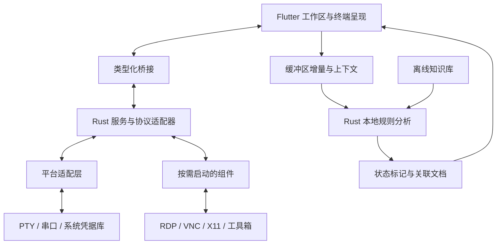

# Geekcore Term 终端系统设计方案

> 状态：已实现本地终端、串口、Telnet、SSH 密码/私钥认证终端、SSH 交互式质询、认证优先级、端口敲门序列、会话记录、顶部连接工具栏和快速连接窗口；SSH Agent、SFTP、监控、助手等功能尚未实现，性能尚未验证。
>
> 日期：2026-10-26
>
> 当前仓库已包含 Flutter/Rust 终端、串口和 Telnet 会话，以及基于 Dart `dartssh2` 的 SSH 密码/私钥认证交互 shell。Flutter 静态分析和 Linux、Android Debug、Web Debug 构建已通过；Android 设备、浏览器网关和真实 SSH 服务器连接尚未实机验收。SFTP、传输、监控及助手仍属于设计目标。

## 1. 已确定的方向

- **技术栈：Rust 核心 + Dart/Flutter 界面**，必要时接入成熟原生库及少量平台代码。Flutter 承担跨端界面，Rust 承担连接、传输、监控及规则分析。[Flutter 架构依据](https://docs.flutter.dev/resources/architectural-overview)
- **平台路线：Windows、Linux 首发；Android 与 Web 已加入项目目标**，平台级完整验收仍待完成；macOS、iOS、边缘设备保留扩展设计。
- **首版目标：覆盖 MobaXterm 的主要工作流**，内部按里程碑推进，完整能力作为 1.0 发布门槛。
- 提供**完整安装包与精简版**。完整版包含主要组件，重型能力按需启动。
- 助手采用**纯本地规则分析**，提供标记、解释和排查文档，不代执行命令。
- 当前交付物为中文 Markdown 设计文档、架构图、界面线框图和接口示例。本文为设计总纲，后续分册尚未编写。

产品面向开发者、运维及网络工程人员，采用本地优先、无需账户的使用方式。用户最初提及的“sfrp”已确认指 SFTP 文件传输。

## 2. 产品能力与界面设计

以 [MobaXterm 官方功能](https://mobaxterm.mobatek.net/features.html)为对照建立矩阵，每项明确首版范围、平台差异、交付方式和验收条件。

| 能力组 | 首版设计范围 |
| --- | --- |
| 终端工作区 | 本地 Shell、SSH、Telnet、串口，多标签、分屏、独立窗口、搜索、日志记录、编码与字体设置 |
| SSH 连接 | 当前实现密码/私钥认证、优先密码/优先密钥/自动模式、交互式质询、交互终端、主机指纹确认及重连；SSH Agent、跳板机和 SSH 配置导入仍待实现 |
| 文件管理 | SFTP/SCP、本地与远端双栏、拖放、多任务传输、可恢复传输、权限管理、远程编辑及保存冲突处理 |
| 网络连接 | 本地、远程、动态 SSH 转发，代理配置与隧道状态管理 |
| 图形访问 | 标签页内 RDP/VNC、SSH X11 转发；完整版提供平台适用的 X11 组件 |
| 工具箱 | Unix 常用工具、网络诊断、密钥工具，以及按需启动的 HTTP/TFTP/SFTP 等服务组件 |
| 自动化 | 命令片段、宏、用户主动运行的脚本和批量输入，明确目标会话及执行范围 |
| 远程监控 | 通过独立 SSH 通道采集 CPU、内存、磁盘、网络及进程，不要求安装 Agent |
| 本地助手 | 缓冲区实时分析、命令与日志状态标记、问题证据、关联排查文档 |

Mosh、XDMCP、旧式 Rlogin/Rsh、通用插件市场、数据库管理列为后续能力。

### 2.1 界面与自定义

主工作区参考 [MobaXterm 的会话管理布局](https://mobaxterm.mobatek.net/documentation.html)：顶部工具栏提供本地终端、串口、Telnet 和 SSH 创建入口，最右侧是快速连接；快速连接用于临时连接，新建会话模式可填写备注名并保存。两种弹窗都在左侧选择协议、右侧填写参数。左侧主栏显示已保存会话与最近连接，已保存项以备注名为主标题、设备路径或 IP/端口为副标题；右侧为会话首页和多标签终端。会话中心支持搜索、重命名、删除及重新打开；普通会话配置保存在本地偏好设置，不包含 SSH 用户名和密码。

支持深浅主题、布局保存、快捷键重映射、字体及配色自定义。Android 单独设计触屏交互。

### 2.2 远程监控

监控默认仅在连接期间采集，保留有限的会话内趋势；不承担离线告警或独立监控平台职责。Linux、Windows 被监控主机分别定义采集方式，无法取得的指标显示“不可用”。

监控采集属于独立的 SSH 监控服务，不赋予助手命令执行权限。

## 3. 架构、接口与数据边界

采用“Flutter 工作区 → 类型化桥接 → Rust 服务与协议适配器 → 系统能力/组件”的分层结构。

本地终端通过 `portable-pty` 启动系统默认 shell；Linux 读取用户默认 `$SHELL`，Windows 读取 `ComSpec`。串口通过跨平台串口适配器打开；设备列表显示端口名和 USB 产品/厂商名称。Telnet 使用 TCP 连接并处理命令转义、选项协商、终端类型和窗口尺寸。SSH 使用 Dart `dartssh2`：桌面与 Android 直接使用 TCP socket，Web 通过用户配置的二进制 WebSocket 网关中继；会话支持密码、私钥和键盘交互式认证，私钥可粘贴或从文件选择。认证优先级可设为密码、密钥或自动；自动模式在有可用私钥时先尝试密钥，失败后继续密码/键盘交互，优先模式在首选方式失败后尝试另一种方式。顶部会话标签同时显示会话名与状态，底部提示条按当前或后台会话显示登录进度；交互式质询弹出按服务端提示填写的对话框。会话还支持交互 shell、输入输出、PTY 尺寸同步及断线重连。连接 SSH 前可按序执行 TCP、UDP、ICMP 敲门和毫秒延迟：TCP 连接一次后关闭，UDP 发送一个空数据报，ICMP 发送一次 Echo Request；桌面与 Android 本地发送，Web 网关须识别 `transport=udp` 和 `transport=icmp`，并使用 `host`、适用时的 `port` 参数代发。首次连接必须确认主机指纹，之后固定指纹；密钥变化会要求用户明确更新信任。四类连接共用 Flutter xterm 呈现、输入队列和标签生命周期；本地 PTY、串口和 Telnet 使用 Rust 字节流，SSH 使用 Dart 流。浏览器版本目前只开放 SSH。SSH 用户名、密码、私钥及私钥口令独立于普通会话配置：桌面默认存入当前用户应用支持目录中的 `ssh/credentials.json`（Linux/macOS 目录 `0700`、文件 `0600`），Android 通过系统加密存储，Web 通过 Web Crypto 存储且仅支持 HTTPS 或 localhost。Linux 输入保留 Flutter 文本输入连接以接收 IBus/Fcitx 组合文本，并通过增量文本更新和光标区域变换定位候选框，避免组合提交重复进入 shell。Flutter 静态分析及 Linux、Android Debug、Web Debug 构建已通过；设备、浏览器网关和 SSH 服务端验收尚待完成。

会话首页使用顶部连接工具栏和左侧会话列表；用户可从工具栏入口或快速连接窗口建立串口/Telnet 连接，将常用配置保存到本机，或从最多 20 条最近连接中重新打开。串口高级参数随会话记录保存；会话记录不存储 Telnet 密码。

### 3.1 分层职责

- **Flutter 层**管理界面、终端呈现及交互；终端组件统一处理屏幕、滚动缓冲和 ANSI 状态，避免维护两套不一致的终端模型。
- **Rust 层**管理本地 PTY、串口、Telnet 会话及未来传输/监控服务；当前 SSH 会话由 Dart `dartssh2` 管理，以复用浏览器 WebSocket transport。
- **平台适配层**隔离 Windows ConPTY、Unix PTY、串口、系统凭据库、图形组件及后台生命周期差异。
- **组件管理**负责版本、启动、退出、升级和故障提示；RDP/VNC、X11、工具箱组件不进入主界面的启动关键路径。

### 3.2 最小接口与核心对象

详细设计需要定义以下最小接口及数据流：

| 接口 | 职责 |
| --- | --- |
| 会话 | 建立、认证、输入输出、尺寸调整、断线、重连与关闭 |
| 传输 | 任务创建、进度、取消、恢复及冲突处理 |
| 监控 | 订阅、指标快照、能力探测及采集错误 |
| 助手 | 接收缓冲区变化、产生分析结果、关联文档；不持有终端输入或命令执行接口 |

核心对象包括 `SessionProfile`、`SessionEvent`、`TransferTask`、`MetricSnapshot`、`AssistantFinding`、`KnowledgeEntry`。这些名称表达设计职责，不代表当前已有实现或稳定接口。

桥接明确字节流分块、取消、背压、错误及资源释放，避免大量输出阻塞界面。配置与资产采用本地存储，凭据独立加密保存，普通导出默认排除秘密。

### 3.3 可选平台边界

- **macOS**：保留桌面适配架构，后续单独验收系统集成与发行。
- **Android**：项目目标已生成并加入系统加密凭据存储；触屏交互、USB 串口、后台生命周期和设备验收仍需单独完成。
- **Web**：目前仅提供 SSH，并已加入浏览器加密凭据存储。SSH 必须经用户提供的二进制 WebSocket 网关；浏览器不能直接访问 TCP，部署环境须使用 HTTPS/WSS。
- **iOS**：存在后台与本地进程限制，需要单独定义能力范围。
- **边缘设备**：区分 Linux 无界面核心与有屏客户端，不承诺覆盖微控制器。

## 4. 本地助手与开放知识库

### 4.1 分析链路

助手采用以下处理链：

**缓冲区增量变化 → 上下文识别 → 本地规则匹配 → 状态标记 → 侧栏证据与文档**

- 分析新增内容和受影响区域，采用有界缓存、合并与去重；不持续重扫全部历史。
- 有 Shell Integration 时利用命令边界和退出状态；没有时使用文本启发式，并标注识别依据与不确定性。
- 将发现绑定到会话、输出位置和时间；旧输出只代表当时观察，不能直接作为当前主机状态。
- 默认显示轻量标记，不抢焦点。点击后展示命中证据、解释、适用条件和排查步骤。
- 分别处理全屏程序、分页器、回车覆盖、重复日志及未知状态，保留原始输出。
- 分析完全在本地运行，不接入大模型，不向模型发送终端数据。

### 4.2 首批规则与文档

- `systemctl status` 的服务状态、失败原因和退出信息。
- 端口占用：Linux 的 `ss/lsof`、Windows 的 PowerShell/网络工具排查流程。
- 权限不足、磁盘或 inode 耗尽、DNS/连接失败、SSH 认证失败。

服务状态与命令退出码分别解释，避免将正常停止或一次性任务误判成故障。[systemctl 状态依据](https://www.freedesktop.org/software/systemd/man/latest/systemctl.html)

例如检测到 `Address already in use` 时，标记相关输出并关联“端口占用排查”文档。文档说明如何定位监听进程、核对服务和处理冲突，不直接推断占用者，也不自动结束进程。

### 4.3 官方与社区协作

知识库采用**开放仓库 + 社区 PR + 官方审核发布**：

- 内容格式为 Markdown 文档与声明式匹配规则；定义稳定 ID、版本、语言、适用平台、证据模式、文档关联及正反例。
- 客户端内置离线快照，支持手动更新、导入和回退；首版不建设在线投稿服务。
- 更新包校验来源与完整性；文档和规则不执行脚本，不自动加载远端内容。
- 排查命令可以复制，由用户自行执行。通用脚本功能与助手保持独立。

## 5. 文档交付与验收

### 5.1 后续文档集

后续在 `docs/` 下形成相互链接的文档集，入口说明放在 `README.md`：

| 文档主题 | 内容 |
| --- | --- |
| 产品需求与功能矩阵 | 用户工作流、首版功能、后续能力、平台差异及验收映射 |
| 架构与技术选型 | 模块边界、协议与组件选型、数据流、桥接、生命周期及技术决策依据 |
| UI/UX | 桌面与触屏交互、工作区布局、主题、快捷键及界面线框图 |
| 助手与知识库规范 | 规则、上下文、证据、文档格式、社区贡献、审核及离线发布 |
| 安全与发行设计 | 主机身份、凭据、导入导出、组件更新、依赖许可及完整/精简发行版 |
| 研发路线与验收标准 | 内部里程碑、技术验证门槛、测试场景、性能预算及发布条件 |

### 5.2 功能验收场景

- 所有首版功能均映射到平台、组件、接口与验收场景；区分设计目标、待技术验证项和已验证事实。
- 覆盖中文输入、宽字符、Vim/tmux、编码、输出洪峰、断网重连、传输中断、主机指纹变化及远程编辑冲突。
- 助手提供正常与异常样例，覆盖日志截断、ANSI 分块、重复提示、误报、知识库更新失败和离线使用。

### 5.3 性能预算

参考桌面环境默认采用四核 CPU、8 GiB 内存、SSD、1080p；以 Release 构建测试不少于 30 次进程冷启动，目标为：

| 指标 | 设计目标 |
| --- | --- |
| 冷启动至可交互 | p95 ≤ 1.5 秒 |
| 空闲进程总内存 | ≤ 200 MiB |
| 重型组件 | 按需启动，不进入主界面启动关键路径 |

详细验收文档需要明确缓存条件、后台组件和各平台统计口径。这些是待实测预算，不是已有性能结果；空闲预算不能替代开启远程桌面或多会话后的负载评估。

### 5.4 技术验证与范围约束

为终端兼容、FFI 数据吞吐、内嵌远程桌面及完整组件发行设置后续技术验证门槛，本阶段不实施验证原型。

云同步、多用户服务和通用第三方插件不进入首版。Android 在 Windows/Linux 之后交付；其他可选平台的架构预留不等同于已实现或已验收。
