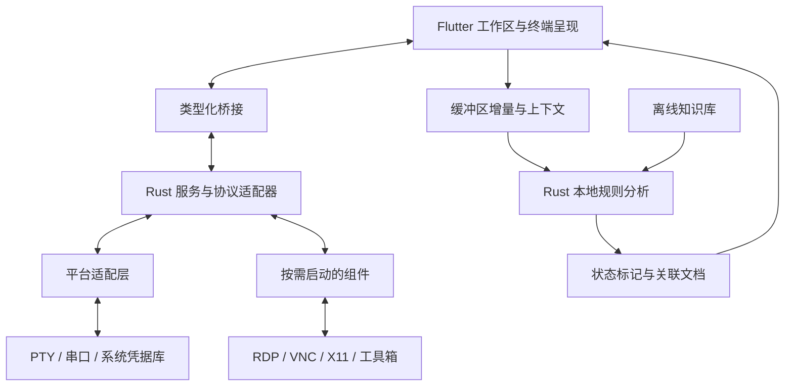

# Geekcore Term 终端系统设计方案

> 状态：主要终端工作流已实现：本地终端、串口、Telnet、SSH、独立 SFTP 文件会话、OpenSSH 配置导入、会话分类与备份、启动时按分类打开已保存会话、多标签拖动排序、2/4 窗格分屏与布局记忆、跨标签多会话输入广播、可重映射终端快捷键、终端 HTTP(S) 链接 Ctrl/Command+单击打开、自定义终端关键字高亮、命令片段、分标签终端输出记录、SFTP/SCP 文件管理与远程文本编辑、会话内 FIFO 传输队列、任务取消与按会话保存任务描述、双栏本地/远端文件管理与有界文件/目录只读比较、SFTP 上传失败续传、双栏 SFTP 下载断点续传、Linux/macOS SSH Agent、SSH 单层跳板、按会话 SOCKS5/HTTP CONNECT 代理、本地/远程/SOCKS5 隧道、Linux/Windows 只读远程监控、本机 DNS/TCP 诊断、用户确认式命令宏与键盘输入录制/重放、本地规则助手、主题、字体与应用设置。RDP/VNC/X11、Windows OpenSSH Agent 命名管道、多跳 `ProxyJump`、SCP 续传、内嵌工具箱与服务、带条件的脚本管理、Shell Integration 和知识库导入/审核尚未实现；性能目标仍待完成。

> 本轮补充：目录比较已接入双栏管理器。只读扫描每侧最多 5000 项、512 个目录和 16 层，按相对路径、类型、大小和修改时间分类；符号链接不跟随，对可用的目录修改时间做前后校验，检测到变化时取消。远端目录未提供修改时间时，界面提示快照一致性无法确认。元数据相同不表示文件内容相同，界面明确显示这一边界。SSH 代理与单文件比较已在 `53d8912` 提交。
>
> 日期：2026-10-27
>
> 本轮验证：`flutter analyze` 无问题，完整 `flutter test` 148 项通过，2 项 opt-in OpenSSH smoke 默认跳过；Linux、Web、Android Debug 构建通过。标签排序覆盖前后移动、原位、非法索引和 Widget 横向拖动；跳板 TCP 敲门覆盖通道关闭、目标拒绝、策略拒绝、超时清理，以及经跳板可用 TCP/延迟、拒绝 UDP/ICMP 的规则。终端链接测试覆盖宽字符前缀、尾随标点、跨行链接、不支持协议、内嵌凭据拒绝、平台修饰键、点击回调和远端鼠标事件拦截。关键字高亮测试覆盖宽字符单元格映射、大小写、短语、行边界、命中上限、覆盖范围清理，设置测试覆盖持久化和规则增删。启动会话组测试覆盖默认关闭、设置持久化、分组筛选、端点去重、顺序连接和用户取消；页面级 FRB mock 验证只连接选中分类且按保存顺序启动，失效分类也可关闭。会话侧栏 ListTile 的点击水波纹背景层告警已修复。另有 `RUN_SSH_TERMINAL_SMOKE=1` 的本机 OpenSSH 回环交互 SSH 与跳板 TCP 敲门通过记录。Android 构建仍有 `desktop_drop` KGP 迁移提示。真实 SSH/网络主机启动连接、桌面鼠标与触屏长按、Windows PowerShell/OpenSSH 主机和真实目标 SFTP 文件传输仍待验收。

## 1. 已确定的方向

- **技术栈：Rust 核心 + Dart/Flutter 界面**，必要时接入成熟原生库及少量平台代码。Flutter 承担跨端界面，Rust 承担连接、传输、监控及规则分析。[Flutter 架构依据](https://docs.flutter.dev/resources/architectural-overview)
- **平台路线：Windows、Linux 首发；Android 与 Web 已加入项目目标**，平台级完整验收仍待完成；macOS、iOS、边缘设备保留扩展设计。
- **首版目标：覆盖 MobaXterm 的主要工作流**，内部按里程碑推进，完整能力作为 1.0 发布门槛。
- 提供**完整安装包与精简版**。完整版包含主要组件，重型能力按需启动。
- 助手采用**纯本地规则分析**，提供标记、解释和排查文档，不代执行命令。
- 当前交付物为中文 Markdown 设计文档、架构图、界面线框图和接口示例。本文为设计总纲，后续分册尚未编写。

产品面向开发者、运维及网络工程人员，采用本地优先、无需账户的使用方式。用户最初提及的“sfrp”已确认指 SFTP 文件传输。

## 2. 产品能力与界面设计

以 [MobaXterm 官方功能](https://mobaxterm.mobatek.net/features.html)为对照建立矩阵，每项明确首版范围、平台差异、交付方式和验收条件。

| 能力组 | 首版设计范围 | 当前实现与边界 |
| --- | --- | --- |
| 终端工作区 | 本地 Shell、SSH、Telnet、串口，多标签、分屏、独立窗口、搜索、日志记录、编码与字体设置 | 本地 Shell、SSH、Telnet、串口、多标签和 2/4 窗格分屏已实现；分屏形状保存在本机，重启后恢复为空窗格，不会自动连接会话；新会话优先填入空窗格。可选择向可见窗格或多个已连接标签广播输入，广播目标在标签栏下方显示。终端搜索当前缓冲区与滚屏记录，支持大小写选项、结果高亮、前后跳转，每次最多显示 2000 个匹配项。字号可调至 10–24 px，字体可选系统等宽、JetBrains Mono、Cascadia Mono、Fira Code、Noto Sans Mono CJK SC，设置保存在本机；字体未安装时由平台回退。主要键盘操作可在设置中改绑，组合保留 Ctrl/Command 并不占用 AltGr。HTTP(S) 链接可 Ctrl/Command+单击打开系统浏览器。设置最多 24 条与 ANSI 独立的自定义关键字/短语高亮规则，支持颜色和大小写选项；每个终端绘制上限 512 个匹配。每标签可记录最多 10 MiB 输出并保存日志，关闭时处理未保存内容。独立窗口和编码设置未实现。 |
| SSH 连接 | 密码/私钥认证、质询、主机信任、配置导入、跳板机、SSH Agent、连接保活 | 密码/私钥、交互式质询、认证优先级、主机指纹确认、手动重连、10/30/60 秒保活、OpenSSH `Host` 导入及 Linux/macOS `SSH_AUTH_SOCK` Agent 身份签名已实现；保活设置只影响新连接。Agent 身份用于普通目标和单层跳板认证，私钥不会复制到本地。可从已保存的直连 SSH 会话选择单层跳板，凭据仍从安全凭据库读取，路由随配置备份保存。配置导入支持首个 `IdentityFile`、基础通配符及单个 `ProxyJump` Host 别名；未知别名、自身跳转、非别名写法、`ProxyCommand` 路由会阻止对应主机导入，避免静默退化为直连。`Include` 和 `Match` 不展开。目标 TCP 敲门可通过跳板的 SSH 转发通道发起；Windows OpenSSH Agent 命名管道、多跳跳转及经跳板执行 UDP/ICMP 敲门未实现。 |
| 文件管理 | SFTP/SCP、本地与远端双栏、拖放、多任务传输、可恢复传输、权限管理、远程编辑及保存冲突处理 | 远端目录浏览和名称筛选、创建目录、重命名、删除、八进制权限修改、SFTP/SCP 上传下载、拖放、会话内 FIFO 队列、UTF-8 文本编辑和本地/远端双栏浏览已实现；双栏支持本地目录遍历、多选上传及下载到所选本地目录，Web 明确禁用本地目录浏览。本机文件系统使用 `dart:io` 适配；Linux 构建和本地服务测试已通过，Windows/macOS 构建与 Android/iOS 系统授权目录运行验收待完成。队列逐项传输、显示进度与结果，可移除等待任务、取消活动任务、清除结束记录，并按会话保存不含凭据的待处理任务描述；重新打开文件页后任务暂停，需检查并手动恢复。可访问的本地路径上传恢复前核对名称、大小和修改时间；内存选择器与 macOS 文件承诺上传源只在当前运行期间有效。清除应用会话数据也会删除队列记录。SFTP 本地路径上传失败或进程中断后保留隐藏部分文件和源版本信息，重试前核对文件名、大小与修改时间，从已有偏移继续并在完成后原子替换；显式取消或源文件变化会清理片段并保留原目标。取消双栏 SFTP 下载会保留隐藏部分文件，重新排队可续传。取消 SCP 上传可能留下不完整远端目标。双栏 SFTP 下载以隐藏部分文件暂存数据，并按连接身份、远端路径、长度、修改时间及权限核对来源；中断后重新排队同一文件到同一目录可续传，来源变化会丢弃旧部分并从头开始。服务端未提供修改时间时退回内存下载；传统保存对话框与 SCP 下载仍缓存内存；SCP 上传和下载不支持续传。SFTP 上传使用同目录临时文件、长度校验和重命名提交，覆盖要求 OpenSSH POSIX rename 扩展，并保留普通 rwx 权限；双栏本地下载写同目录临时文件，覆盖前确认，检查目标版本并尝试失败回滚。远端文件名做跨平台路径校验，拒绝本地符号链接与目录目标。编辑器限制 2 MiB，并检查远端版本、同目录临时文件写入和原子重命名。SCP 上传遵从远端 `scp` 写入行为。 |
| 文件比较 | 本地与远端普通文件、目录树只读比较 | 文件比较：单文件不超过 2 MiB，读取前后检查版本，拒绝远端符号链接；UTF-8 文本使用有界 LCS 对齐插入/删除，二进制或无效 UTF-8 只显示状态；每侧最多 1200 行和 900000 个矩阵单元。目录比较：每侧最多 5000 项、512 个目录和 16 层；比较相对路径、类型、大小、修改时间，不读取文件内容；符号链接只列出、不跟随；扫描受限时显示不完整状态。 |
| 网络连接 | 本地、远程、动态 SSH 转发，代理配置与隧道状态管理 | 本地 `-L`、远程 `-R`、SOCKS5 动态 `-D` 和隧道管理已实现，默认绑定 loopback。桌面/Android 原生 TCP SSH/SFTP 支持按会话 SOCKS5（无认证或 RFC 1929 用户名/密码）和 HTTP CONNECT（可选 Basic）；代理密码进入现有平台凭据库，不写入会话配置。Web 仍走 WebSocket 网关；代理与跳板、端口敲门不组合。HTTP Basic 没有 TLS 包装。 |
| 图形访问 | 标签页内 RDP/VNC、SSH X11 转发；完整版提供平台适用的 X11 组件 | 未实现；暂缓到图形协议平台适配与组件发行单独完成后。 |
| 工具箱 | Unix 常用工具、网络诊断、密钥工具，以及按需启动的 HTTP/TFTP/SFTP 等服务组件 | 本机网络诊断已实现 DNS 查询和单目标 TCP 端口握手检查，桌面和 Android 可用；不发送应用层数据、不保存目标记录。Unix 工具包、密钥工具及内嵌 HTTP/TFTP/SFTP 服务未实现；浏览器不具备本机 TCP 诊断能力。 |
| 自动化 | 命令片段、命令宏、键盘录制、用户主动运行的脚本和批量输入，明确目标会话及执行范围 | 本地命令片段已实现，只允许单行并粘贴到当前终端、不自动发送 Enter；命令宏可创建、编辑、删除并保存最多 40 行、16 KiB 脚本，每次执行前显示完整脚本和冻结的目标标签供确认；按行追加 Enter，通过目标会话既有输入队列串行发送，目标断开或重连后停止剩余行并报告已完成数量。另可录制当前标签的键盘、文本/IME、特殊键和粘贴输入；鼠标事件及终端自动回复不纳入录制。录制最多 2048 个输入片段、16 KiB，每段间隔封顶 1 秒，最多保存 32 个宏，达到录制限额自动停止。回放前显示控制字节可读预览及冻结的会话目标，要求用户勾选检查后按原字节片段顺序写入各目标的输入队列，断线、重连或用户停止会中止后续片段并报告部分完成。保存前展示完整输入预览并要求勾选确认不含秘密；未保存录制按标签保留；关闭标签时可保存、丢弃或取消关闭。键盘录制宏保存在普通本地偏好设置中且未加密，不能录入密码或令牌。分屏广播和多会话输入广播可由用户主动开启，多会话模式按已连接标签选择目标并显示醒目目标条；剪贴板、命令片段和远端路径粘贴会先确认目标。带条件、循环和变量的脚本管理仍未实现。 |
| 远程监控 | 通过 SSH 采集系统负载、内存、磁盘、网络及进程，不要求安装 Agent | Linux 与 Windows 已实现只读快照：活跃 SSH 标签可见时每 5 秒采集负载平均值、内存、根文件系统、进程数、CPU 使用较高的前 5 个进程，以及所有非 `lo` 接口的收发字节计数；相邻快照按实际间隔计算收发速度，计数器回退或间隔无效时不显示对应速度。切换标签后首个样本重置网络速率基线。虚拟网桥可能重复计数。最多保留 24 个样本。终端底部单行指标栏与顶部工具栏打开的详细弹窗共享该标签的 `SshRemoteMonitorCache`；切换到其他标签时暂停采样但保留缓存，重新切回时继续，关闭 SSH 标签后清除。脚本只读 `/proc`，调用 `awk`、`df`、`ps`；Windows OpenSSH 使用固定 PowerShell/CIM 脚本采集指标并映射到同一快照模型，真实 Windows 主机仍待验收。 |
| 本地助手 | 缓冲区实时分析、命令与日志状态标记、问题证据、关联排查文档 | 已接入本地增量规则分析：识别端口占用、权限拒绝、存储耗尽、DNS 解析失败、连接拒绝/超时、systemd failed 状态和命令未找到；跨 ANSI 分块识别、每标签最多保留 50 条线索，30 秒内相同证据去重，重连时清空旧证据。左侧助手栏展示匹配片段、解释、核查步骤和可复制命令；所有结果标为文本启发式，可能匹配到 shell 回显，不判断当前主机状态；命令只复制、不自动执行。Shell Integration、命令边界和退出码分析、开放知识库导入/审核仍未实现。 |

### 2.1 MobaXterm 非游戏能力覆盖审计

对照 [MobaXterm 官方功能列表](https://mobaxterm.mobatek.net/features.html) 与[官方手册](https://mobaxterm.mobatek.net/documentation.html)（2026-10-27 检查）。此表跟踪主要产品功能，桌面、Web 和移动端差异必须在实现与验收时单独记录。

| 能力 | Geekcore Term 当前状态与缺口 |
| --- | --- |
| 远程会话类型 | SSH、独立 SFTP 文件会话、Telnet、串口已实现；FTP/FTPS、Rlogin/Rsh、Mosh、RDP、VNC、XDMCP 未实现。独立 SFTP 会话复用 SSH 认证与主机信任，不启动 Shell；SSH 标签也保留文件浏览器和 SFTP/SCP 传输。 |
| 标签与窗口 | 多标签拖动排序（桌面直接拖动、触屏长按）、2/4 窗格、输入广播已实现；标签拖出/重附、独立终端窗口和全屏远程桌面工作区未实现。 |
| 会话管理 | 保存、最近连接、分类、重命名、JSON 导入/导出已实现；可选择一个分类在下次启动时自动按顺序打开其已保存会话，默认关闭，手动发起新连接会停止本轮剩余的自动启动。桌面快捷方式、启动参数连接/运行脚本、团队共享会话未实现。 |
| SSH 文件浏览 | SFTP/SCP、双栏、拖放、断点续传、远端 UTF-8 编辑和有界只读文件/目录比较已实现；FTP/FTPS 文件浏览和传输未实现。 |
| 图形远程访问 | SSH X11 转发、X11 Server/扩展、RDP、VNC、XDMCP 均未实现。 |
| 多机操作与宏 | 显式目标输入广播、逐行命令宏和经预览/确认的键盘输入录制重放已实现；有条件、循环、变量的命令序列/启动脚本编排尚未实现。 |
| 内嵌服务 | HTTP、TFTP、FTP、SSH/SFTP、Telnet 服务管理入口及守护进程生命周期未实现。 |
| 图形工具箱 | 本机 DNS/TCP 诊断、双栏本地/远端 UTF-8 文件差异和目录树元数据比较已实现；图像查看、端口分析、抓包工具未实现。 |
| Unix 工具与扩展 | 本机系统 Shell 已实现；Windows 版 Unix 命令兼容层、MobApt 类包管理、可签名/审核的插件安装与更新未实现。 |
| 终端体验 | ANSI、主题、字体、搜索、日志和快捷键配置已实现；终端 HTTP(S) 链接支持 Ctrl/Command+单击打开系统浏览器，并拒绝含内嵌用户名或密码的 URL。自定义关键字/短语高亮可按字面匹配，设置颜色和大小写敏感度，最多 24 条规则；每个终端最多绘制 512 个匹配，高频输出时扫描最近缓冲区范围。会话级字符集/编码配置、平台路径映射命令未实现。 |
| 凭据保护 | 平台凭据存储、主密码启动锁已实现；由主密码派生密钥保护凭据库、密码导入/导出及恢复流程未实现。当前启动锁不加密 SSH 凭据库。 |
| 发行定制 | 完整版/精简版组件边界、用户品牌和默认配置定制器未实现；需纳入发行与签名供应链设计。 |

游戏相关功能不纳入范围。数据库管理和通用第三方插件市场不是当前 MobaXterm 对照表中的既定核心项，先保留为后续扩展，不视为首轮覆盖门槛。

### 2.2 界面与自定义

主工作区参考 [MobaXterm 的会话管理布局](https://mobaxterm.mobatek.net/documentation.html)：顶部工具栏提供本地终端、串口、Telnet、SSH 和网络诊断入口，最右侧是快速连接；小窗口切换为图标工具栏和“更多工具”菜单。首页显示本地终端、SSH、串口和 Telnet 快捷入口；快速连接用于临时连接，新建会话模式可填写备注名并保存。左侧主栏显示已保存会话与最近连接，支持搜索、分类、重命名、删除、重新打开及 JSON 备份导入/导出；右侧为会话首页和多标签终端。终端工作区可切换单窗、左右、上下或四窗模式，并由用户启用分屏输入广播；活跃 SSH 标签的远程指标收纳在终端区底部一行，点击底栏或顶部工具栏的监控按钮打开详细弹窗，两者共享同一标签缓存。桌面工具栏提供命令片段、命令宏和键盘录制入口，紧凑布局放入“更多工具”菜单；录制中会在工具栏和标签上显示红色标识。小于 600 px 的窄屏收起固定侧栏，通过“更多工具”底部面板访问会话、文件和助手。SSH 文件侧栏可打开 HexHub 风格双栏管理器，桌面横向显示本地与远端目录，紧凑屏幕用“本地/远端”分段切换；当前连接的 SSH 标签仍作为远端文件上下文。

双栏管理器可分别选择一个本地和远端普通文件进行只读比较；UTF-8 文本在并列视图中标出插入与删除行，二进制或超出比较上限时明确显示状态。无选择时可比较两侧当前目录，也可比较两侧选中的目录树；扫描相对路径、类型、文件大小和修改时间，符号链接只显示、不跟随。目录比较不会读取文件内容，也不会执行文件写入或同步；“元数据一致”不能作为内容字节一致的证明。扫描结果明确区分触及扫描上限和远端目录修改时间不可用两种状态。

产品设计范围包含深浅主题、布局保存、快捷键重映射、字体及配色自定义。新配置默认使用 HexHub 风格浅色主题；设置页同时提供翡翠、海洋、石墨三种深色主题。终端字号及常见等宽字体选择已实现，字体不随安装包捆绑。应用支持启动主密码锁、桌面窗口位置和大小记忆，以及清除本地会话、主机信任、SSH 凭据和设置数据。终端分屏形状已持久化，重启后恢复为空窗格；默认不自动连接，用户可选择启动会话组来按序打开已保存连接。主要终端快捷键可在设置中改绑，按键组合使用 Ctrl/Command 和可选 Shift，以保留 Alt/AltGr 输入。布局尺寸与窗格到会话的命名预设仍未实现。主密码用于应用启动解锁，不作为 SSH 凭据加密密钥。Android 单独设计触屏交互。

### 2.3 远程监控

底部监控栏在活跃 SSH 标签显示期间每 5 秒采样并保留最近 24 个快照；切换到其他标签会暂停采样并保留该 SSH 标签缓存，切回后继续，关闭 SSH 标签才释放趋势数据。点击底栏或顶部工具栏监控按钮打开详细弹窗，两个视图直接读取并刷新同一个 per-session `SshRemoteMonitorCache`；关闭弹窗不会停止底栏采样。该功能不承担离线告警或独立监控平台职责。当前 Linux 采集通过 SSH 执行固定的只读命令，读取 `/proc` 并调用 `awk`、`df`、`ps`，显示负载平均值、内存、根文件系统、进程数、CPU 使用较高的前 5 个进程和非 `lo` 接口收发速度；速度由相邻字节计数和实际采样时间计算，计数器回退或时间间隔无效时隐藏对应值。切换标签后首个样本重置速率基线。虚拟网桥可能造成重复计数。缺少工具或主机不提供 Linux `/proc` 时显示明确错误；Windows OpenSSH 使用固定 PowerShell/CIM 脚本采集指标并映射到同一快照模型，真实 Windows 主机仍待验收。监控与本地助手分离，不向助手授予命令执行权限。

监控采集属于独立的 SSH 监控服务，不赋予助手命令执行权限。

## 3. 架构、接口与数据边界

采用“Flutter 工作区 → 类型化桥接 → Rust 服务与协议适配器 → 系统能力/组件”的分层结构。

本地终端通过 `portable-pty` 启动系统默认 shell；Linux 读取用户默认 `$SHELL`，Windows 读取 `ComSpec`。串口通过跨平台串口适配器打开；Telnet 使用 TCP 并处理命令转义、选项协商、终端类型和窗口尺寸。SSH shell、独立 SFTP 文件会话、SFTP/SCP 文件操作和端口转发使用 Dart `dartssh2`；SFTP 会话使用 SSH 传输与认证，但不创建 shell。桌面与 Android 默认直连 TCP socket，也可按会话配置 SOCKS5 或 HTTP CONNECT 代理；Web 通过用户配置的二进制 WebSocket 网关中继，不能静默退回本机直连。Linux/macOS 在 `SSH_AUTH_SOCK` 可用时读取系统 Agent 公钥并通过 SSH Agent 协议请求签名，身份不写入本地凭据库；Windows OpenSSH Agent 命名管道适配尚未实现。会话支持密码、私钥和键盘交互式认证，优先密码、优先密钥或自动认证；私钥可粘贴或从文件选择。桌面端可读取默认或指定 OpenSSH 配置文件并预览 `Host` 别名，导入 `HostName`、`User`、`Port` 和第一个 `IdentityFile`；单个 `ProxyJump` Host 别名解析为一层跳板，并从别名配置读取地址、端口、用户名和密钥路径；未知别名、多跳、自身跳转及 `ProxyCommand` 路由会阻止对应主机导入，避免导入后静默改成直连。`Include` 不展开，`Match` 条件及其中配置跳过。连接支持交互 shell、PTY 尺寸同步和首次主机指纹确认；密钥变化会阻止连接，直到用户明确更新信任。用户可选择一个已保存的直连 SSH/SFTP 会话作为跳板机，使用已有的密钥、交互式认证、凭据存储和主机指纹确认；仅支持一层。目标 TCP 端口敲门通过跳板的 `direct-tcpip` 通道发起，UDP/ICMP 仍仅支持直连；端口敲门支持按序 TCP、UDP、ICMP 和延迟。SSH 文件页支持远端目录操作、SFTP/SCP 传输及 UTF-8 文本编辑；SFTP 上传先写同目录临时文件、校验长度，再重命名提交，覆盖要求 OpenSSH POSIX rename 扩展；SCP 上传遵从远端 `scp` 写入行为。传输通过会话内 FIFO 队列逐项执行并显示单项进度，可移除等待任务、取消活动任务；队列任务描述按会话保存在普通应用偏好中，不含凭据，重开文件页后需确认恢复。仅本地路径上传可恢复，并在恢复前核对文件名、大小和修改时间；内存选择器和 macOS 文件承诺源不支持跨重启恢复。双栏管理器的 SFTP 下载流式写入本地隐藏部分文件，并按连接身份、路径、长度、修改时间和权限验证续传来源；中断后重新排队同一远端文件到同一目标目录时续传。服务端未提供修改时间时回退到缓存下载，SCP 和传统保存对话框下载仍缓存在内存，不支持续传。SFTP 本地路径上传可通过失败任务重试从隐藏部分文件续传；内存源无法持久化或续传。SSH 隧道支持本地 `-L`、远程 `-R` 与 SOCKS5 `-D`，默认仅绑定 loopback；Web 当前不支持本机监听隧道。SSH 与 SFTP 会话共用标签生命周期和文件管理器，SSH shell 另提供终端呈现、输入队列及 PTY 尺寸同步；本地 PTY、串口和 Telnet 使用 Rust 字节流，SSH/SFTP 使用 Dart 流。SSH 用户名、密码、私钥和私钥口令独立于秘密凭据库；会话配置可保存用户名、配置别名和私钥路径，但不会保存凭据正文。桌面默认将凭据存入当前用户应用支持目录的 `ssh/credentials.json`（Linux/macOS 目录 `0700`、文件 `0600`），Android 使用系统加密存储，Web 使用 Web Crypto 且仅支持 HTTPS 或 localhost。Linux 输入保留 Flutter 文本输入连接以接收 IBus/Fcitx 组合文本，并通过增量文本更新和光标区域变换定位候选框，避免组合提交重复进入 shell。

会话首页使用顶部连接工具栏和左侧会话/文件切换栏；用户可从工具栏建立 SSH、SFTP、串口或 Telnet 会话，也可通过快速连接窗口临时连接；常用配置可保存到本机，或从最多 20 条最近连接中重新打开。SFTP 使用独立文件会话，不启动 shell；保存配置复用 SSH 凭据身份。会话可以分类，支持 JSON 备份导入/导出；备份不包含密码、私钥正文或凭据库。串口高级参数随会话记录保存；会话记录不存储 Telnet 密码。

### 3.1 分层职责

- **Flutter 层**管理界面、终端呈现及交互；终端组件统一处理屏幕、滚动缓冲和 ANSI 状态，避免维护两套不一致的终端模型。
- **Rust 层**管理本地 PTY、串口、Telnet 会话及未来传输服务；当前 SSH 会话和只读远程监控由 Dart `dartssh2` 管理，以复用浏览器 WebSocket transport。
- **平台适配层**隔离 Windows ConPTY、Unix PTY、串口、系统凭据库、图形组件及后台生命周期差异。
- **组件管理**负责版本、启动、退出、升级和故障提示；RDP/VNC、X11、工具箱组件不进入主界面的启动关键路径。

### 3.2 最小接口与核心对象

终端、文件会话和 Linux SSH 监控的实际实现位于 `lib/terminal/`；下表仅描述内部职责，不构成稳定外部 API：

| 接口 | 职责 |
| --- | --- |
| 会话 | 建立、认证、输入输出、尺寸调整、断线、重连与关闭 |
| 传输 | 任务创建、进度、取消、恢复及冲突处理 |
| 监控 | 订阅、指标快照、能力探测及采集错误 |
| 助手 | 接收缓冲区变化、产生分析结果、关联文档；不持有终端输入或命令执行接口 |

规划对象包括 `SessionProfile`、`SessionEvent`、`TransferTask`、`MetricSnapshot`、`AssistantFinding`、`KnowledgeEntry`。当前监控快照使用内部 `SshRemoteMetrics` 类型；其他尚未实现的名称仍只表达设计职责，不代表已有功能或稳定接口。

桥接明确字节流分块、取消、背压、错误及资源释放，避免大量输出阻塞界面。配置与资产采用本地存储；当前 SSH 凭据按平台存储方式保护：桌面保存在当前用户应用支持目录的私有文件中，Android 使用系统加密存储，Web 使用浏览器加密存储。主密码只锁定应用启动，不会再加密该凭据库。普通导出默认排除秘密。

### 3.3 可选平台边界

- **macOS**：保留桌面适配架构，后续单独验收系统集成与发行。
- **Android**：项目目标已生成并加入系统加密凭据存储；触屏交互、USB 串口、后台生命周期和设备验收仍需单独完成。
- **Web**：目前仅提供 SSH，并已加入浏览器加密凭据存储。SSH 必须经用户提供的二进制 WebSocket 网关；浏览器不能直接访问 TCP，部署环境须使用 HTTPS/WSS。
- **iOS**：存在后台与本地进程限制，需要单独定义能力范围。
- **边缘设备**：区分 Linux 无界面核心与有屏客户端，不承诺覆盖微控制器。

## 4. 本地助手与开放知识库

### 4.1 分析链路

助手采用以下处理链：

**缓冲区增量变化 → 上下文识别 → 本地规则匹配 → 状态标记 → 侧栏证据与文档**

- 分析新增内容和受影响区域，采用有界缓存、合并与去重；不持续重扫全部历史。
- 有 Shell Integration 时利用命令边界和退出状态；没有时使用文本启发式，并标注识别依据与不确定性。
- 将发现绑定到会话、输出位置和时间；旧输出只代表当时观察，不能直接作为当前主机状态。
- 默认显示轻量标记，不抢焦点。点击后展示命中证据、解释、适用条件和排查步骤。
- 分别处理全屏程序、分页器、回车覆盖、重复日志及未知状态，保留原始输出。
- 分析完全在本地运行，不接入大模型，不向模型发送终端数据。

当前实现通过每标签独立分析器消费新增输出，先过滤分块 ANSI 转义，再在最多 256 个字符的上下文窗口内匹配首批规则；历史证据最多 50 条，重复证据在 30 秒内合并。左侧“终端助手”栏不抢终端焦点，展示规则命中片段、时间、解释和核查步骤；建议命令仅复制到剪贴板。分析器在会话重连时重置，关闭标签后释放。当前没有 Shell Integration，所有匹配均为文本启发式，不等同于命令退出状态或当前服务状态。

### 4.2 首批规则与文档

- `systemctl status` 的服务状态、失败原因和退出信息。
- 端口占用：Linux 的 `ss/lsof`、Windows 的 PowerShell/网络工具排查流程。
- 权限不足、磁盘或 inode 耗尽、DNS/连接失败、SSH 认证失败。

上述常见文本线索已由内置规则初步识别；服务状态与命令退出码仍须分别解释，避免将正常停止或一次性任务误判成故障。[systemctl 状态依据](https://www.freedesktop.org/software/systemd/man/latest/systemctl.html)

例如检测到 `Address already in use` 时，标记相关输出并关联“端口占用排查”文档。文档说明如何定位监听进程、核对服务和处理冲突，不直接推断占用者，也不自动结束进程。

### 4.3 官方与社区协作

知识库采用**开放仓库 + 社区 PR + 官方审核发布**：

- 内容格式为 Markdown 文档与声明式匹配规则；定义稳定 ID、版本、语言、适用平台、证据模式、文档关联及正反例。
- 客户端内置离线快照，支持手动更新、导入和回退；首版不建设在线投稿服务。
- 更新包校验来源与完整性；文档和规则不执行脚本，不自动加载远端内容。
- 排查命令可以复制，由用户自行执行。通用脚本功能与助手保持独立。

## 5. 文档交付与验收

### 5.1 后续文档集

后续在 `docs/` 下形成相互链接的文档集，入口说明放在 `README.md`：

| 文档主题 | 内容 |
| --- | --- |
| 产品需求与功能矩阵 | 用户工作流、首版功能、后续能力、平台差异及验收映射 |
| 架构与技术选型 | 模块边界、协议与组件选型、数据流、桥接、生命周期及技术决策依据 |
| UI/UX | 桌面与触屏交互、工作区布局、主题、快捷键及界面线框图 |
| 助手与知识库规范 | 规则、上下文、证据、文档格式、社区贡献、审核及离线发布 |
| 安全与发行设计 | 主机身份、凭据、导入导出、组件更新、依赖许可及完整/精简发行版 |
| 研发路线与验收标准 | 内部里程碑、技术验证门槛、测试场景、性能预算及发布条件 |

### 5.2 功能验收场景

- 会话与配置：验证本地 Shell、串口、Telnet、SSH 连接流程；保存/重开/重命名/分类；旧配置兼容；备份去重且不包含秘密凭据。
- 终端呈现：验证多标签、2/4 窗布局、布局恢复、焦点切换、广播输入默认关闭及后台会话状态；覆盖快捷键改绑、组合冲突、AltGr/中文输入、宽字符、Vim/tmux、编码和输出洪峰。
- SSH：验证首次主机指纹确认、密钥变化阻断、认证回退、断线重连、配置导入边界、敲门顺序及隧道结束时资源清理。
- 键盘录制宏：自动测试覆盖 UTF-8 和控制字节、xterm 中文/按键/粘贴回调、终端自动回复排除、单条和总量限制、延迟封顶、按目标队列重放、中止/失败报告、持久化清理、审核勾选及手机尺寸；实际桌面/SSH 输入、IME 与广播回放仍待人工验收。
- 窄屏布局：360 px Widget 检查覆盖首页无横向溢出，以及会话、文件、助手底部面板切换；Android 真机触控、键盘弹出时滚动和软键盘布局仍待验收。
- 远程监控：Linux 使用固定只读 shell 脚本采集负载、内存、根文件系统、进程和网络计数；Windows OpenSSH 首次采样用固定 `cmd.exe` 探测并缓存平台，随后以 UTF-16LE 编码的固定 PowerShell 命令通过 CIM 和网卡统计采集 CPU、内存、系统盘、进程和网络计数。两端共享相同的每会话缓存与详情 UI，分别显示 Linux 负载或 Windows CPU 百分比。自动测试覆盖 Linux 实际采集、Windows 协议解析和命令脚本只读约束、网络速率与缓存生命周期及 360 px 窄屏布局；Windows PowerShell 执行与真实 Windows SSH 主机仍待验收。
- 文件：验证 SFTP/SCP 上传下载、文件名校验、同目录临时写入、覆盖提示、活动取消、2 MiB/UTF-8 编辑限制和远端版本变化冲突；验证双栏 SFTP 下载中断或取消后从部分文件恢复、来源变化时丢弃旧片段并重新开始，以及本地路径上传失败后核对源版本并从远端部分文件续传；本地 OpenSSH SFTP 上传/下载续传和取消回环已通过，真实目标服务器与 SCP 传输仍需执行。
- 平台：区分本机 TCP、WebSocket 网关、浏览器文件选择和 Android/桌面生命周期；桌面 UI 需人工确认键盘、IME、拖放和窗口缩放。
- 助手规则验收：提供正常与异常样例，覆盖日志截断、ANSI 分块、重复提示、误报、知识库更新失败和离线使用。

历史回归记录（当前验证见文首）：此前 `flutter analyze` 无问题，114 项单元/Widget 测试通过，默认套件中 2 项 opt-in OpenSSH smoke 跳过；Linux、Web、Android Debug 构建通过。本轮远程监控专项测试 12 项通过，覆盖 Linux 实际采集、Windows 样例解析、UTF-16LE PowerShell 命令解码及只读约束、网络速率边界和底栏/详情窄屏布局。Widget/存储测试覆盖分屏布局保存、启动后显示空窗格且不自动连接，以及清除应用数据时重置布局；快捷键测试覆盖录制、持久化、重复组合拒绝和不匹配 Alt 输入；助手测试覆盖 ANSI 跨块识别、短时去重、上下文/历史上限、重连重置和手机宽度侧栏；监控测试覆盖网络计数、冒号接口别名、收发速度边界、暂停与在途采样作废、底栏/详情窄屏布局，固定采集脚本在本机 Linux 上通过。独立 OpenSSH SFTP smoke 验证上传失败后从部分文件续传、上传取消后保留原目标并清理临时文件、下载取消后保留部分文件并续传、取消缓冲下载后同一 SFTP 会话仍可用；交互式 SSH 输入及逐行命令宏 loopback OpenSSH smoke 已通过。队列模型覆盖 SSH 重连后同会话等待/失败任务重新绑定及保留可清理的失败上传记录；Flutter 文件侧栏队列和多会话广播 UI 尚未通过人工操作验收。此前隔离 OpenSSH 回环覆盖队列传输、Agent 登录、SSH 隧道、Linux 远程监控、SFTP 覆盖保护及网络诊断。窄窗口 Widget 检查覆盖 800 px 首页、360 px 终端首页与侧栏面板、网络诊断、助手和监控栏/弹窗。尚未完成 Windows/macOS 构建、Windows 真实 PowerShell/OpenSSH 运行、真实目标服务器与 SCP 文件传输、浏览器网关、Android 设备交互、远端权限和编辑冲突操作及性能测量；界面截图仅验证首页布局，不视作完整交互验收。

本轮目录比较回归覆盖相对路径合并、类型/大小/修改时间差异、缺失元数据、不完整扫描、512 目录限制、远端条目路径校验、扫描时目录变更检测及不可变 SFTP 列表；本地临时目录和模拟 SFTP 树均验证不跟随符号链接。320×568 窄屏结果弹窗通过 Widget 检查。完整 `flutter test` 为 171 项通过、2 项 opt-in OpenSSH smoke 跳过；`flutter analyze` 无问题；Linux Debug、Web Debug（`--no-wasm-dry-run`）、Android Debug 构建通过。Android 构建仍输出 `desktop_drop` 使用旧式 Kotlin Gradle Plugin 的上游迁移警告。真实 SSH/SFTP 代理链路、真实远端目录比较、Windows/macOS 构建和 Android 真机交互仍待验收。

### 5.3 性能预算

参考桌面环境默认采用四核 CPU、8 GiB 内存、SSD、1080p；以 Release 构建测试不少于 30 次进程冷启动，目标为：

| 指标 | 设计目标 |
| --- | --- |
| 冷启动至可交互 | p95 ≤ 1.5 秒 |
| 空闲进程总内存 | ≤ 200 MiB |
| 重型组件 | 按需启动，不进入主界面启动关键路径 |

详细验收文档需要明确缓存条件、后台组件和各平台统计口径。这些是待实测预算，不是已有性能结果；空闲预算不能替代开启远程桌面或多会话后的负载评估。

### 5.4 技术验证与范围约束

为终端兼容、FFI 数据吞吐、内嵌远程桌面及完整组件发行设置后续技术验证门槛，本阶段不实施验证原型。

云同步、多用户服务和通用第三方插件不进入首版。Android 在 Windows/Linux 之后交付；其他可选平台的架构预留不等同于已实现或已验收。
