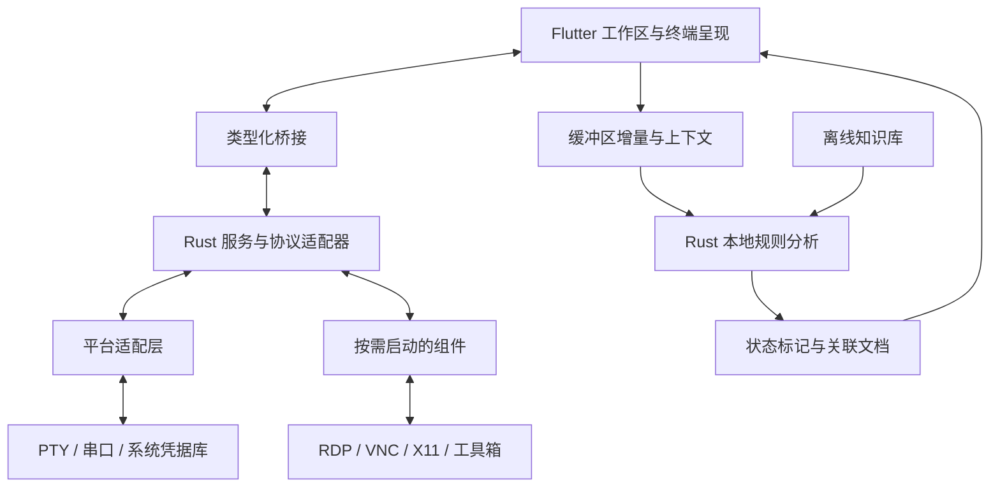

# Geekcore Term 终端系统设计方案

> 状态：主要终端工作流已实现：本地终端、串口、Telnet、SSH、OpenSSH 配置导入、会话分类与备份、2/4 窗格分屏与布局记忆、跨标签多会话输入广播、可重映射终端快捷键、命令片段、分标签终端输出记录、SFTP/SCP 文件管理与远程文本编辑、会话内 FIFO 传输队列、任务取消与按会话保存任务描述、双栏本地/远端文件管理、SFTP 上传失败续传、双栏 SFTP 下载断点续传、Linux/macOS SSH Agent、SSH 单层跳板、本地/远程/SOCKS5 隧道、Linux 只读远程监控、本机 DNS/TCP 诊断、主题、字体与应用设置。RDP/VNC/X11、Windows OpenSSH Agent 命名管道、多跳 `ProxyJump`、SCP 续传、内嵌工具箱与服务、宏和本地助手尚未实现；Windows 远程监控与性能目标仍待完成。
>
> 日期：2026-10-27
>
> 本轮验证：`flutter analyze` 无问题，完整默认套件 87 项通过、2 项 opt-in OpenSSH smoke 默认跳过。Linux、Web、Android Debug 构建通过（Web 有 flutter_rust_bridge Wasm dry-run 警告，Android 有 `desktop_drop` KGP 迁移提示）。Widget/存储测试覆盖分屏布局恢复为空窗格且不自动连接、快捷键录制与持久化、冲突拒绝、Alt 组合不匹配，应用数据清除会重置布局和快捷键。临时本机 OpenSSH SFTP smoke 验证上传失败后从远端部分文件续传、取消上传时保留原目标并清理临时文件、取消下载后保留部分文件并续传、缓冲下载取消后 SFTP 会话仍可用；交互式 SSH 输入 smoke 已通过。真实 SSH 文件侧栏和多会话广播 UI 尚未完成手动验收。Windows/macOS 构建、Android/iOS 系统授权目录运行、真实目标服务器与 SCP 文件传输验收、性能指标及完整界面交互验收仍未完成。

## 1. 已确定的方向

- **技术栈：Rust 核心 + Dart/Flutter 界面**，必要时接入成熟原生库及少量平台代码。Flutter 承担跨端界面，Rust 承担连接、传输、监控及规则分析。[Flutter 架构依据](https://docs.flutter.dev/resources/architectural-overview)
- **平台路线：Windows、Linux 首发；Android 与 Web 已加入项目目标**，平台级完整验收仍待完成；macOS、iOS、边缘设备保留扩展设计。
- **首版目标：覆盖 MobaXterm 的主要工作流**，内部按里程碑推进，完整能力作为 1.0 发布门槛。
- 提供**完整安装包与精简版**。完整版包含主要组件，重型能力按需启动。
- 助手采用**纯本地规则分析**，提供标记、解释和排查文档，不代执行命令。
- 当前交付物为中文 Markdown 设计文档、架构图、界面线框图和接口示例。本文为设计总纲，后续分册尚未编写。

产品面向开发者、运维及网络工程人员，采用本地优先、无需账户的使用方式。用户最初提及的“sfrp”已确认指 SFTP 文件传输。

## 2. 产品能力与界面设计

以 [MobaXterm 官方功能](https://mobaxterm.mobatek.net/features.html)为对照建立矩阵，每项明确首版范围、平台差异、交付方式和验收条件。

| 能力组 | 首版设计范围 | 当前实现与边界 |
| --- | --- | --- |
| 终端工作区 | 本地 Shell、SSH、Telnet、串口，多标签、分屏、独立窗口、搜索、日志记录、编码与字体设置 | 本地 Shell、SSH、Telnet、串口、多标签和 2/4 窗格分屏已实现；分屏形状保存在本机，重启后恢复为空窗格，不会自动连接会话；新会话优先填入空窗格。可选择向可见窗格或多个已连接标签广播输入，广播目标在标签栏下方显示。终端搜索当前缓冲区与滚屏记录，支持大小写选项、结果高亮、前后跳转，每次最多显示 2000 个匹配项。字号可调至 10–24 px，字体可选系统等宽、JetBrains Mono、Cascadia Mono、Fira Code、Noto Sans Mono CJK SC，设置保存在本机；字体未安装时由平台回退。主要键盘操作可在设置中改绑，组合保留 Ctrl/Command 并不占用 AltGr。每标签可记录最多 10 MiB 输出并保存日志，关闭时处理未保存内容。独立窗口和编码设置未实现。 |
| SSH 连接 | 密码/私钥认证、质询、主机信任、配置导入、跳板机、SSH Agent、连接保活 | 密码/私钥、交互式质询、认证优先级、主机指纹确认、手动重连、10/30/60 秒保活、OpenSSH `Host` 导入及 Linux/macOS `SSH_AUTH_SOCK` Agent 身份签名已实现；保活设置只影响新连接。Agent 身份用于普通目标和单层跳板认证，私钥不会复制到本地。可从已保存的直连 SSH 会话选择单层跳板，凭据仍从安全凭据库读取，路由随配置备份保存。配置导入支持首个 `IdentityFile`、基础通配符及单个 `ProxyJump` Host 别名；未知别名、自身跳转、非别名写法、`ProxyCommand` 路由会阻止对应主机导入，避免静默退化为直连。`Include` 和 `Match` 不展开。Windows OpenSSH Agent 命名管道、多跳跳转和经跳板执行目标端口敲门未实现。 |
| 文件管理 | SFTP/SCP、本地与远端双栏、拖放、多任务传输、可恢复传输、权限管理、远程编辑及保存冲突处理 | 远端目录浏览和名称筛选、创建目录、重命名、删除、八进制权限修改、SFTP/SCP 上传下载、拖放、会话内 FIFO 队列、UTF-8 文本编辑和本地/远端双栏浏览已实现；双栏支持本地目录遍历、多选上传及下载到所选本地目录，Web 明确禁用本地目录浏览。本机文件系统使用 `dart:io` 适配；Linux 构建和本地服务测试已通过，Windows/macOS 构建与 Android/iOS 系统授权目录运行验收待完成。队列逐项传输、显示进度与结果，可移除等待任务、取消活动任务、清除结束记录，并按会话保存不含凭据的待处理任务描述；重新打开文件页后任务暂停，需检查并手动恢复。可访问的本地路径上传恢复前核对名称、大小和修改时间；内存选择器与 macOS 文件承诺上传源只在当前运行期间有效。清除应用会话数据也会删除队列记录。SFTP 本地路径上传失败或进程中断后保留隐藏部分文件和源版本信息，重试前核对文件名、大小与修改时间，从已有偏移继续并在完成后原子替换；显式取消或源文件变化会清理片段并保留原目标。取消双栏 SFTP 下载会保留隐藏部分文件，重新排队可续传。取消 SCP 上传可能留下不完整远端目标。双栏 SFTP 下载以隐藏部分文件暂存数据，并按连接身份、远端路径、长度、修改时间及权限核对来源；中断后重新排队同一文件到同一目录可续传，来源变化会丢弃旧部分并从头开始。服务端未提供修改时间时退回内存下载；传统保存对话框与 SCP 下载仍缓存内存；SCP 上传和下载不支持续传。SFTP 上传使用同目录临时文件、长度校验和重命名提交，覆盖要求 OpenSSH POSIX rename 扩展，并保留普通 rwx 权限；双栏本地下载写同目录临时文件，覆盖前确认，检查目标版本并尝试失败回滚。远端文件名做跨平台路径校验，拒绝本地符号链接与目录目标。编辑器限制 2 MiB，并检查远端版本、同目录临时文件写入和原子重命名。SCP 上传遵从远端 `scp` 写入行为。 |
| 网络连接 | 本地、远程、动态 SSH 转发，代理配置与隧道状态管理 | 本地 `-L`、远程 `-R`、SOCKS5 动态 `-D` 和隧道管理已实现；默认绑定 loopback。按会话代理配置未实现。 |
| 图形访问 | 标签页内 RDP/VNC、SSH X11 转发；完整版提供平台适用的 X11 组件 | 未实现；暂缓到图形协议平台适配与组件发行单独完成后。 |
| 工具箱 | Unix 常用工具、网络诊断、密钥工具，以及按需启动的 HTTP/TFTP/SFTP 等服务组件 | 本机网络诊断已实现 DNS 查询和单目标 TCP 端口握手检查，桌面和 Android 可用；不发送应用层数据、不保存目标记录。Unix 工具包、密钥工具及内嵌 HTTP/TFTP/SFTP 服务未实现；浏览器不具备本机 TCP 诊断能力。 |
| 自动化 | 命令片段、宏、用户主动运行的脚本和批量输入，明确目标会话及执行范围 | 本地命令片段已实现，只允许单行并粘贴到当前终端、不自动发送 Enter；分屏广播和多会话输入广播可由用户主动开启，多会话模式按已连接标签选择目标并显示醒目目标条。键盘输入（包括 Enter）会发往选中终端；剪贴板、命令片段和远端路径粘贴会先确认目标。宏和脚本管理未实现。 |
| 远程监控 | 通过 SSH 采集系统负载、内存、磁盘、网络及进程，不要求安装 Agent | Linux 已实现只读快照：每 5 秒采集负载平均值、内存、根文件系统、进程数和 CPU 使用较高的前 5 个进程；界面保留最多 24 个样本并在关闭后清除。脚本只读 `/proc`，调用 `awk`、`df`、`ps`；不支持 Windows 主机，网络吞吐采集未实现。 |
| 本地助手 | 缓冲区实时分析、命令与日志状态标记、问题证据、关联排查文档 | 未实现，保留为后续本地规则能力；不得代替用户执行命令。 |

Mosh、XDMCP、旧式 Rlogin/Rsh、通用插件市场、数据库管理列为后续能力。

### 2.1 界面与自定义

主工作区参考 [MobaXterm 的会话管理布局](https://mobaxterm.mobatek.net/documentation.html)：顶部工具栏提供本地终端、串口、Telnet、SSH 和网络诊断入口，最右侧是快速连接；小窗口切换为图标工具栏和“更多工具”菜单。首页显示本地终端、SSH、串口和 Telnet 快捷入口；快速连接用于临时连接，新建会话模式可填写备注名并保存。左侧主栏显示已保存会话与最近连接，支持搜索、分类、重命名、删除、重新打开及 JSON 备份导入/导出；右侧为会话首页和多标签终端。终端工作区可切换单窗、左右、上下或四窗模式，并由用户启用分屏输入广播。SSH 文件侧栏可打开 HexHub 风格双栏管理器，桌面横向显示本地与远端目录，紧凑屏幕用“本地/远端”分段切换；当前连接的 SSH 标签仍作为远端文件上下文。

产品设计范围包含深浅主题、布局保存、快捷键重映射、字体及配色自定义。新配置默认使用 HexHub 风格浅色主题；设置页同时提供翡翠、海洋、石墨三种深色主题。终端字号及常见等宽字体选择已实现，字体不随安装包捆绑。应用支持启动主密码锁、桌面窗口位置和大小记忆，以及清除本地会话、主机信任、SSH 凭据和设置数据。终端分屏形状已持久化，重启后仅恢复空窗格，避免未经用户操作自动建立本地或远端连接；主要终端快捷键可在设置中改绑，按键组合使用 Ctrl/Command 和可选 Shift，以保留 Alt/AltGr 输入。布局尺寸与窗格到会话的命名预设仍未实现。主密码用于应用启动解锁，不作为 SSH 凭据加密密钥。Android 单独设计触屏交互。

### 2.2 远程监控

监控默认仅在监控窗口打开期间采集，5 秒更新一次并保留最多 24 个样本；关闭窗口后清除趋势，不承担离线告警或独立监控平台职责。当前 Linux 采集通过 SSH 执行固定的只读命令，读取 `/proc` 并调用 `awk`、`df`、`ps`，显示负载平均值、内存、根文件系统、进程总数和 CPU 使用较高的前 5 个进程。缺少工具或主机不提供 Linux `/proc` 时显示明确错误；Windows 主机与网络吞吐指标尚未实现。监控与本地助手分离，不向助手授予命令执行权限。

监控采集属于独立的 SSH 监控服务，不赋予助手命令执行权限。

## 3. 架构、接口与数据边界

采用“Flutter 工作区 → 类型化桥接 → Rust 服务与协议适配器 → 系统能力/组件”的分层结构。

本地终端通过 `portable-pty` 启动系统默认 shell；Linux 读取用户默认 `$SHELL`，Windows 读取 `ComSpec`。串口通过跨平台串口适配器打开；Telnet 使用 TCP 并处理命令转义、选项协商、终端类型和窗口尺寸。SSH、SSH shell、SFTP/SCP 和端口转发使用 Dart `dartssh2`；桌面与 Android 直接使用 TCP socket，Web 通过用户配置的二进制 WebSocket 网关中继。Linux/macOS 在 `SSH_AUTH_SOCK` 可用时读取系统 Agent 公钥并通过 SSH Agent 协议请求签名，身份不写入本地凭据库；Windows OpenSSH Agent 命名管道适配尚未实现。会话支持密码、私钥和键盘交互式认证，优先密码、优先密钥或自动认证；私钥可粘贴或从文件选择。桌面端可读取默认或指定 OpenSSH 配置文件并预览 `Host` 别名，导入 `HostName`、`User`、`Port` 和第一个 `IdentityFile`；单个 `ProxyJump` Host 别名解析为一层跳板，并从别名配置读取地址、端口、用户名和密钥路径；未知别名、多跳、自身跳转及 `ProxyCommand` 路由会阻止对应主机导入，避免导入后静默改成直连。`Include` 不展开，`Match` 条件及其中配置跳过。连接支持交互 shell、PTY 尺寸同步、断线重连和首次主机指纹确认；密钥变化会阻止连接，直到用户明确更新信任。用户可选择一个已保存的直连 SSH 会话作为跳板机，使用已有的密钥、交互式认证、凭据存储和主机指纹确认；仅支持一层，目标端口敲门暂不可通过跳板发送。端口敲门支持按序 TCP、UDP、ICMP 和延迟。SSH 文件页支持远端目录操作、SFTP/SCP 传输及 UTF-8 文本编辑；SFTP 上传先写同目录临时文件、校验长度，再重命名提交，覆盖要求 OpenSSH POSIX rename 扩展；SCP 上传遵从远端 `scp` 写入行为。传输通过会话内 FIFO 队列逐项执行并显示单项进度，可移除等待任务、取消活动任务；队列任务描述按会话保存在普通应用偏好中，不含凭据，重开文件页后需确认恢复。仅本地路径上传可恢复，并在恢复前核对文件名、大小和修改时间；内存选择器和 macOS 文件承诺源不支持跨重启恢复。双栏管理器的 SFTP 下载流式写入本地隐藏部分文件，并按连接身份、路径、长度、修改时间和权限验证续传来源；中断后重新排队同一远端文件到同一目标目录时续传。服务端未提供修改时间时回退到缓存下载，SCP 和传统保存对话框下载仍缓存在内存，不支持续传。SFTP 本地路径上传可通过失败任务重试从隐藏部分文件续传；内存源无法持久化或续传。SSH 隧道支持本地 `-L`、远程 `-R` 与 SOCKS5 `-D`，默认仅绑定 loopback；Web 当前不支持本机监听隧道。四类连接共用 Flutter xterm 呈现、输入队列和标签生命周期；本地 PTY、串口和 Telnet 使用 Rust 字节流，SSH 使用 Dart 流。SSH 用户名、密码、私钥和私钥口令独立于秘密凭据库；会话配置可保存用户名、配置别名和私钥路径，但不会保存凭据正文。桌面默认将凭据存入当前用户应用支持目录的 `ssh/credentials.json`（Linux/macOS 目录 `0700`、文件 `0600`），Android 使用系统加密存储，Web 使用 Web Crypto 且仅支持 HTTPS 或 localhost。Linux 输入保留 Flutter 文本输入连接以接收 IBus/Fcitx 组合文本，并通过增量文本更新和光标区域变换定位候选框，避免组合提交重复进入 shell。

会话首页使用顶部连接工具栏和左侧会话/文件切换栏；用户可从工具栏或快速连接窗口建立连接，将常用配置保存到本机，或从最多 20 条最近连接中重新打开。会话可以分类，支持 JSON 备份导入/导出；备份不包含密码、私钥正文或凭据库。串口高级参数随会话记录保存；会话记录不存储 Telnet 密码。

### 3.1 分层职责

- **Flutter 层**管理界面、终端呈现及交互；终端组件统一处理屏幕、滚动缓冲和 ANSI 状态，避免维护两套不一致的终端模型。
- **Rust 层**管理本地 PTY、串口、Telnet 会话及未来传输服务；当前 SSH 会话和只读远程监控由 Dart `dartssh2` 管理，以复用浏览器 WebSocket transport。
- **平台适配层**隔离 Windows ConPTY、Unix PTY、串口、系统凭据库、图形组件及后台生命周期差异。
- **组件管理**负责版本、启动、退出、升级和故障提示；RDP/VNC、X11、工具箱组件不进入主界面的启动关键路径。

### 3.2 最小接口与核心对象

终端、文件会话和 Linux SSH 监控的实际实现位于 `lib/terminal/`；下表仅描述内部职责，不构成稳定外部 API：

| 接口 | 职责 |
| --- | --- |
| 会话 | 建立、认证、输入输出、尺寸调整、断线、重连与关闭 |
| 传输 | 任务创建、进度、取消、恢复及冲突处理 |
| 监控 | 订阅、指标快照、能力探测及采集错误 |
| 助手 | 接收缓冲区变化、产生分析结果、关联文档；不持有终端输入或命令执行接口 |

规划对象包括 `SessionProfile`、`SessionEvent`、`TransferTask`、`MetricSnapshot`、`AssistantFinding`、`KnowledgeEntry`。当前监控快照使用内部 `SshRemoteMetrics` 类型；其他尚未实现的名称仍只表达设计职责，不代表已有功能或稳定接口。

桥接明确字节流分块、取消、背压、错误及资源释放，避免大量输出阻塞界面。配置与资产采用本地存储；当前 SSH 凭据按平台存储方式保护：桌面保存在当前用户应用支持目录的私有文件中，Android 使用系统加密存储，Web 使用浏览器加密存储。主密码只锁定应用启动，不会再加密该凭据库。普通导出默认排除秘密。

### 3.3 可选平台边界

- **macOS**：保留桌面适配架构，后续单独验收系统集成与发行。
- **Android**：项目目标已生成并加入系统加密凭据存储；触屏交互、USB 串口、后台生命周期和设备验收仍需单独完成。
- **Web**：目前仅提供 SSH，并已加入浏览器加密凭据存储。SSH 必须经用户提供的二进制 WebSocket 网关；浏览器不能直接访问 TCP，部署环境须使用 HTTPS/WSS。
- **iOS**：存在后台与本地进程限制，需要单独定义能力范围。
- **边缘设备**：区分 Linux 无界面核心与有屏客户端，不承诺覆盖微控制器。

## 4. 本地助手与开放知识库

### 4.1 分析链路

助手采用以下处理链：

**缓冲区增量变化 → 上下文识别 → 本地规则匹配 → 状态标记 → 侧栏证据与文档**

- 分析新增内容和受影响区域，采用有界缓存、合并与去重；不持续重扫全部历史。
- 有 Shell Integration 时利用命令边界和退出状态；没有时使用文本启发式，并标注识别依据与不确定性。
- 将发现绑定到会话、输出位置和时间；旧输出只代表当时观察，不能直接作为当前主机状态。
- 默认显示轻量标记，不抢焦点。点击后展示命中证据、解释、适用条件和排查步骤。
- 分别处理全屏程序、分页器、回车覆盖、重复日志及未知状态，保留原始输出。
- 分析完全在本地运行，不接入大模型，不向模型发送终端数据。

### 4.2 首批规则与文档

- `systemctl status` 的服务状态、失败原因和退出信息。
- 端口占用：Linux 的 `ss/lsof`、Windows 的 PowerShell/网络工具排查流程。
- 权限不足、磁盘或 inode 耗尽、DNS/连接失败、SSH 认证失败。

服务状态与命令退出码分别解释，避免将正常停止或一次性任务误判成故障。[systemctl 状态依据](https://www.freedesktop.org/software/systemd/man/latest/systemctl.html)

例如检测到 `Address already in use` 时，标记相关输出并关联“端口占用排查”文档。文档说明如何定位监听进程、核对服务和处理冲突，不直接推断占用者，也不自动结束进程。

### 4.3 官方与社区协作

知识库采用**开放仓库 + 社区 PR + 官方审核发布**：

- 内容格式为 Markdown 文档与声明式匹配规则；定义稳定 ID、版本、语言、适用平台、证据模式、文档关联及正反例。
- 客户端内置离线快照，支持手动更新、导入和回退；首版不建设在线投稿服务。
- 更新包校验来源与完整性；文档和规则不执行脚本，不自动加载远端内容。
- 排查命令可以复制，由用户自行执行。通用脚本功能与助手保持独立。

## 5. 文档交付与验收

### 5.1 后续文档集

后续在 `docs/` 下形成相互链接的文档集，入口说明放在 `README.md`：

| 文档主题 | 内容 |
| --- | --- |
| 产品需求与功能矩阵 | 用户工作流、首版功能、后续能力、平台差异及验收映射 |
| 架构与技术选型 | 模块边界、协议与组件选型、数据流、桥接、生命周期及技术决策依据 |
| UI/UX | 桌面与触屏交互、工作区布局、主题、快捷键及界面线框图 |
| 助手与知识库规范 | 规则、上下文、证据、文档格式、社区贡献、审核及离线发布 |
| 安全与发行设计 | 主机身份、凭据、导入导出、组件更新、依赖许可及完整/精简发行版 |
| 研发路线与验收标准 | 内部里程碑、技术验证门槛、测试场景、性能预算及发布条件 |

### 5.2 功能验收场景

- 会话与配置：验证本地 Shell、串口、Telnet、SSH 连接流程；保存/重开/重命名/分类；旧配置兼容；备份去重且不包含秘密凭据。
- 终端呈现：验证多标签、2/4 窗布局、布局恢复、焦点切换、广播输入默认关闭及后台会话状态；覆盖快捷键改绑、组合冲突、AltGr/中文输入、宽字符、Vim/tmux、编码和输出洪峰。
- SSH：验证首次主机指纹确认、密钥变化阻断、认证回退、断线重连、配置导入边界、敲门顺序及隧道结束时资源清理。
- 远程监控：在隔离 Linux SSH 主机验证只读采集、缺少 `/proc` 或工具时的错误提示、连续采样、窗口关闭后的定时器清理；Windows 主机采集仍待实现。
- 文件：验证 SFTP/SCP 上传下载、文件名校验、同目录临时写入、覆盖提示、活动取消、2 MiB/UTF-8 编辑限制和远端版本变化冲突；验证双栏 SFTP 下载中断或取消后从部分文件恢复、来源变化时丢弃旧片段并重新开始，以及本地路径上传失败后核对源版本并从远端部分文件续传；本地 OpenSSH SFTP 上传/下载续传和取消回环已通过，真实目标服务器与 SCP 传输仍需执行。
- 平台：区分本机 TCP、WebSocket 网关、浏览器文件选择和 Android/桌面生命周期；桌面 UI 需人工确认键盘、IME、拖放和窗口缩放。
- 助手后续验收：提供正常与异常样例，覆盖日志截断、ANSI 分块、重复提示、误报、知识库更新失败和离线使用。

当前证据：`flutter analyze` 无问题，87 项单元/Widget 测试通过，默认套件中 2 项 opt-in OpenSSH smoke 跳过；Linux、Web、Android Debug 构建通过。Widget/存储测试覆盖分屏布局保存、启动后显示空窗格且不自动连接，以及清除应用数据时重置布局；快捷键测试覆盖录制、持久化、重复组合拒绝和不匹配 Alt 输入。独立 OpenSSH SFTP smoke 验证上传失败后从部分文件续传、上传取消后保留原目标并清理临时文件、下载取消后保留部分文件并续传、取消缓冲下载后同一 SFTP 会话仍可用；交互式 SSH 输入 smoke 已通过。队列模型覆盖 SSH 重连后同会话等待/失败任务重新绑定及保留可清理的失败上传记录；Flutter 文件侧栏队列和多会话广播 UI 尚未通过人工操作验收。此前隔离 OpenSSH 回环覆盖队列传输、Agent 登录、SSH 隧道、Linux 远程监控、SFTP 覆盖保护及网络诊断。窄窗口 Widget 检查覆盖 800 px 首页布局；网络诊断对话框覆盖 360 px 手机窗口。尚未完成 Windows/macOS 构建、真实目标服务器与 SCP 文件传输、浏览器网关、Android 设备交互、远端权限和编辑冲突操作及性能测量；界面截图仅验证首页布局，不视作完整交互验收。

### 5.3 性能预算

参考桌面环境默认采用四核 CPU、8 GiB 内存、SSD、1080p；以 Release 构建测试不少于 30 次进程冷启动，目标为：

| 指标 | 设计目标 |
| --- | --- |
| 冷启动至可交互 | p95 ≤ 1.5 秒 |
| 空闲进程总内存 | ≤ 200 MiB |
| 重型组件 | 按需启动，不进入主界面启动关键路径 |

详细验收文档需要明确缓存条件、后台组件和各平台统计口径。这些是待实测预算，不是已有性能结果；空闲预算不能替代开启远程桌面或多会话后的负载评估。

### 5.4 技术验证与范围约束

为终端兼容、FFI 数据吞吐、内嵌远程桌面及完整组件发行设置后续技术验证门槛，本阶段不实施验证原型。

云同步、多用户服务和通用第三方插件不进入首版。Android 在 Windows/Linux 之后交付；其他可选平台的架构预留不等同于已实现或已验收。
